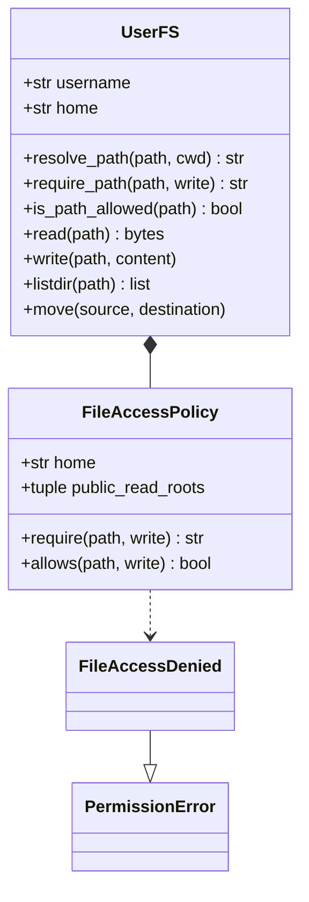

# 文件与个人资料访问模块设计

- 关联需求：[opt-user-space / REQ-002](../dev-workflow/opt-user-space/requirements.md)，AC-005～009；依赖 REQ-001 已实现的可信身份、唯一 home。
- 修订：v1.0，2026-10-29（Asia/Shanghai）；R2 设计与测试基线，业务实现待 R4。
- 源码基线：`codex/opt-req002` / `59eac68b4c0314ab633c376de82a539af3c98d52`，Open Terminal 0.14.5。Open WebUI v0.12.3 为只读依赖。
- 相关代码：[file_access.py](../../open_terminal/utils/file_access.py)、[fs.py](../../open_terminal/utils/fs.py)、[dependencies.py](../../open_terminal/dependencies.py)、[main.py](../../open_terminal/main.py)、[search.py](../../open_terminal/utils/search.py)、[file_compare.py](../../open_terminal/utils/file_compare.py)、[skills.py](../../open_terminal/utils/skills.py)。
- 关联设计：[工作空间身份](workspace-identity.md)；本轮交付与实际测试结果见 [REQ-002 R2 交接](../dev-workflow/opt-user-space/REQ-002/handoff-r2.md)。
- 用户后续验收范围（2026-10-30）：Office 预览文档内部引用其他用户资料不纳入本轮测试和验收阻碍，不为此限制现有工具/Agent 能力；主文档授权及其他入口规则保持。该范围补充优先于下文辅助处理的一般表述，完整决定和测试处置见 [REQ-002 验收范围](../dev-workflow/opt-user-space/REQ-002/acceptance-scope.md)。本条记录用户直接指令，不改变现有实现。

## 职责与范围

统一产品文件入口的路径归属、读写权限及辅助处理授权。保留 FastAPI 路由、响应结构、`UserFS` 和现有读写/搜索/对比/技能实现；在共享路径策略和绕过它的直接 I/O 入口补齐检查。实例 key 与用户身份验证先于本模块，home 由 REQ-001 提供，不根据请求路径推导身份。

本轮不实现业务逻辑，不修改 Open WebUI 或部署。按 D01 不建立任意命令/代码的安全边界，不处理恶意并发换链；不增加用户容器、共享授权平台、资源配额、历史迁移或 Notebook 验收。管理员经产品 API 使用时遵守同一归属规则。服务进程能读取文件，不代表产品请求有权读取。

## 架构与接口

上图描述 R4 完成后的协作。R2 新建 `FileAccessPolicy`、配置解析入口和 `UserFS.require_path` 骨架；方法显式抛 `NotImplementedError`，尚未接线，现有行为保留。类实例只保存契约所需的数据，不提前实现路径算法。

`require_path(path, write=False)` 是实际 I/O 前的唯一授权入口。多用户模式使用 `FileAccessPolicy`；单用户模式维持原文件访问能力，不隐式启用多用户限制。保留 `is_path_allowed(path)` 作为读权限布尔适配器供过滤使用；保留 `_check_path(path)` 作为读检查兼容入口。写调用点必须显式请求写权限，不能继续复用只读检查。无需替换已有执行器，也不把所有 I/O 改成用户子进程。

## 路径与权限契约

| 路径区域 | 读、列表、搜索、预览、对比、归档 | 写、上传、替换、mkdir、删除、移动 |
| --- | --- | --- |
| 当前用户的完整 home 及其子项 | 允许，仍服从实际文件存在性及 OS 权限 | 允许；home 根本身不得删除或移动 |
| 管理员显式声明的公共只读根 | 允许；链接目标仍需逐个校验 | 拒绝，与 OS mode 是否可写无关 |
| 其他用户 home、`/home`、`/`、服务目录和未声明的外部路径 | 拒绝 | 拒绝 |

相对路径仍以现有聊天 cwd 或本人 home 为基准。保留 `/home/user` 和 `/home/usr` 的精确根/子路径别名，只改写到本人 home；类似 `/home/username` 不作别名。别名改写先于授权，不能靠别名加 `..` 进入其他账号。不会新增 `~otheruser` 等账号解析功能。

多用户 `resolve_path` 不得在解析软链之前用 `normpath` 消除 `..`。例如 `home/link-to-B-dir/../secret.txt` 必须按链接的真实目标判断，不能变成 `home/secret.txt`。策略接收绝对路径，使用路径组件边界判断归属，不能把 `alice-extra` 视为 `alice` 子目录。

同时验证词法入口与最终真实目标；每次软链跳转也必须仍在本次操作允许的根内。外部路径即使链接回本人也不能成为入口；本人链接指向公共资料可以读不能写；公共链接指向本人也不能用于写入；经过他人目录再跳回本人仍拒绝。不得通过先 `realpath` 再丢掉原入口来绕过这些规则。

允许不存在的普通尾部路径，以支持创建父目录和新文件；已存在祖先必须逐层解析。断链、环、非目录中间项、NUL、相对策略输入和无法判定的解析错误均拒绝，不能以 `realpath(strict=False)` 的宽松结果直接授权。归属允许但最终文件不存在时，HTTP 按原接口返回 404；策略本身不负责证明文件存在。

`require` 返回获准的 canonical I/O 路径；普通读取/写入、metadata、流式响应和辅助 worker 使用该结果。`remove/move` 对链接有特殊语义：先校验入口及目标，但对最终链接条目本身执行 unlink/rename，不将删除链接变为删除链接目标；父目录以已校验真实目录定位。home 根保护同时考虑实际目标。递归删除不跟随目录链接；跨文件系统移动的复制回退必须保留软链而不跟随读取外部目标。此处只约束正常操作语义，不提供并发换链防护。

`UserFS.move` 与 HTTP 保持一致：源和最终目标均先获得写权限；目标已存在返回冲突，禁止让 `shutil.move` 隐式追加 basename 改变落点；目标父目录必须存在。检查全部完成之后才移动，不先改源再发现目标越权。本人目录中含越权链接时，移动/删除整个目录可操作本人的链接条目，但不能读取、复制或删除其外部目标。

显式起点或文件越权统一抛 `FileAccessDenied('Access denied')`，HTTP 403、`{"detail":"Access denied"}`。拒绝先于 exists/stat、内容读取、搜索、转换、压缩和写副作用，不通过不同 404/403 暴露越权路径是否存在。保留框架原有请求结构校验；无效请求的 422 不作为授权成功或失败证据。`PermissionError` 不得被 `except OSError` 转成含路径的 400；对比接口也不附带文件名。普通获准文件的非授权错误沿用接口语义，避免原样返回包含其他路径或内容的底层异常。

## 公共只读资料配置

新增管理员配置 `OPEN_TERMINAL_PUBLIC_READ_ROOTS`，格式为 JSON 字符串数组，缺省 `[]`。例如 `["/opt/reference"]`。沿用项目配置文件通道时键为 `public_read_roots`，值为同格式字符串，环境变量优先；不新增 UI、上传接口或授权管理。`FILE_BROWSER_ROOT` 仍只是导航设置，不能扩大文件权限。

`parse_public_read_roots` 验证整份配置后返回按输入顺序去重的 canonical tuple；任何项非法则整份失败。只允许存在的绝对目录，目录自身及其已有祖先均不能是软链。拒绝空字符串、非数组、非字符串项、相对路径、文件、缺失目录、文件系统根；拒绝与保护根有祖先/后代重叠，按组件判断而非字符串前缀。

生产保护根至少包括整个 `/home`（包含 REQ-001 的 `.open-terminal`）、实际服务账号 home、`LOG_DIR`、`tempfile.gettempdir()`、`/root`、`/proc`、`/sys`、`/dev`。服务 home 取服务账号事实，不信任用户请求或命令环境的 HOME。禁止将 `/tmp` 等服务临时根及其子目录或上级目录声明为公共；公共基础资料应使用独立目录，例如 `/opt/reference`。其他公共内容由管理员明确选择；普通个人文件不会因 world-readable、服务进程可读或位于 `/home` 外就自动公开。

多用户启动时验证配置，错误抛 `PublicRootConfigurationError('Invalid public read roots')`，不能静默忽略坏项、回退全盘可读或等普通用户首个请求时才暴露路径。R4 在 `env.py` 提供已验证的 `PUBLIC_READ_ROOTS`，`dependencies.get_filesystem` 将它传给 `UserFS` 的可选关键字参数 `public_read_roots=()`，不改变现有两个位置参数。R2 已声明并保存该参数，尚未启用检查。显式单用户模式不启用这套授权，也不因无用的多用户公共配置阻止启动，导出的 `PUBLIC_READ_ROOTS` 为 `()`。

公共根声明不保证软链子项可读，子项每次按请求者重新授权。公共目录内指向 A 的链接不会使 B 读到 A。OS 只读挂载可作为部署补充，产品只读检查必须独立成立。

## 现有入口接入与边界

| 入口 / 代码符号 | R4 接入要求 | 黑盒依据 |
| --- | --- | --- |
| `UserFS.read/read_text/exists/isfile/isdir/stat` | 先读授权，再 I/O；stat 的 writable 合并写策略和实际 OS 可写状态 | `test_file_access_policy.py`、`test_userfs_contract.py` |
| `UserFS.listdir/walk` | 显式起点先授权；每个子项在 stat/open/返回名称前过滤；循环/断链跳过，递归不跟随目录链接 | 同上及 `test_file_http.py` |
| `write/write_bytes/mkdir/remove/move` | 使用写授权，先完成所有校验再创建目录/chown/写入；移动和删除按上一节契约 | `test_userfs_contract.py`、`test_file_http.py` |
| `/files/cwd`、`/files/list`、`display` | 先校验查询路径；cwd 继续按 home+聊天保存；导航设置不是权限 | `test_file_http.py`；REQ-001 既有回归 |
| `/files/read`、`view`、`serve` | 文本/图片/下载/Office 源文件授权一致；服务端临时产物绑定当前获准请求 | `test_file_auxiliary.py` |
| `/files/write/mkdir/delete/move/replace/upload` | 显式写授权；replace 在读取和匹配前拒绝只读目标；upload 检查目录及最终文件，保留 multipart basename 与流式处理 | `test_file_http.py` |
| `/files/grep` | 起点在 exists 前授权；单文件和递归每个文件在 open 前授权；保留正则和结果限制 | `test_file_http.py` |
| `/files/glob` | 起点与全部文件/目录候选在 metadata 前授权，不仅过滤子目录 | `test_file_http.py` |
| `/files/matches/search`、`search_entries/walk_entries` | 起点越权改为统一 403；保留 Git/rg/fallback；结果不暴露过滤项，不跨越目录链接扫描 | `test_file_http.py`、`test_userfs_contract.py` |
| `/files/compare`、`run_comparison` | 两输入全部授权后才启动现有用户 worker；保留比较限制，不靠 worker OS 权限替代检查 | `test_file_auxiliary.py` |
| `/files/archive` | 显式列表中任一路径非法则整次拒绝且不产出部分 ZIP；授权目录递归过滤非法子项，逐文件授权后读取 | `test_file_auxiliary.py` |
| `/skills`、`/skills/read`、`list_skill_resources` | 非法技能根/目录/SKILL.md/资源项过滤，合法项仍可发现；被过滤名称读取为现有 404；资源实际下载走统一文件授权 | `test_file_auxiliary.py` |

辅助提取、Office 转换仍可沿用服务进程或现有 worker，输入必须先授权；不得通过转换失败的通用 catch 回退到未授权原文件。服务临时 JSON/PDF/ZIP/文本只由这次响应持有，沿用 `TemporaryFileResponse` 与 finally 清理，不加入公共根，也不返回供其他请求读取的临时路径。用户程序自行公开服务的内容按 D08，端口代理归属另由 REQ-004 处理。

## 验证与实现交接

黑盒测试位于 [tests/req002](../../tests/req002)，用真实 Linux 文件、软链及真实 FastAPI 路由验证。策略测试直接调用新增骨架，HTTP 测试调用现有公开接口，断言始终期待正确业务行为，不把未实现当成功、不使用 xfail。正常功能通过项与新增契约失败项一起构成 R2 基线。

外部依赖隔离：HTTP fixture 只替换 REQ-001 的账号准备边界，使用一次性 Docker 内 root 账号配合 A/B 独立临时 home；不模拟路径决策、`UserFS` 或业务返回。公共配置作为管理员输入注入已加载模块；`test_public_config.py` 另用新 Python 进程验证真实配置加载、环境优先级、保护根、启动失败和单用户忽略行为，避免 fixture 隐藏接线遗漏。Office 转换的授权顺序测试允许隔离外部转换器；真实文档提取、文本比较、ZIP 读取使用现有实现。搜索补充真实 Git 仓库以及禁用外部搜索工具的 fallback 对照。

运行目录为 WSL Ubuntu-24.04 的 `~/projects/webui/open-terminal`，用 [Dockerfile](../../tests/req002/Dockerfile) 从当前 Linux 运行镜像重新构建独立测试镜像，复制 Windows 工作区源码；不挂载部署卷、不发布端口。所有源码、测试、设计及证据保存均在 Windows，WSL 只构建/运行/测试。实际命令、镜像 ID、用例计数及分类在交接记录中维护。

R4/R5 仍需：真实服务 UID1000 下的组权限与 I/O；真实 LibreOffice 转换与断线清理；当前部署挂载公共只读根后的 A/B 普通账号文件、AI 调用、预览、静态资源及技能链路；身份/Notebook关闭回归。REQ-001 历史通过记录不是 REQ-002 实际集成验收。本轮无影响设计的待确认业务事项。
