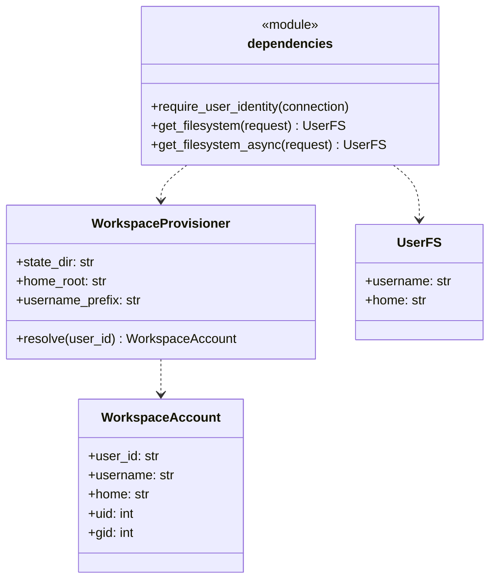

# 可信身份与工作空间归属模块设计

- 关联需求：[opt-user-space / REQ-001](../dev-workflow/opt-user-space/requirements.md)，AC-001～004、AC-032～033；恢复契约关联 REQ-007 的 AC-023、AC-034。
- 修订：v1.4，2026-11-02，后台准备、就绪快速路径与分层锁；身份/归属及恢复规则继续保留。
- 基线：Open Terminal 0.14.5；Open WebUI v0.12.3 只读；从 `codex/opt-req001` / `59eac68` 创建 `codex/opt-req001-fix`。
- 代码：[identity.py](../../open_terminal/utils/identity.py)、[user_isolation.py](../../open_terminal/utils/user_isolation.py)、[dependencies.py](../../open_terminal/dependencies.py)；接入位置 [main.py](../../open_terminal/main.py)。
- v1.0～v1.2 为 R2 设计、接口骨架与测试交付；后续实现及验收见 [R4 交接](../dev-workflow/opt-user-space/REQ-001/handoff-r4.md)和 [R5 交接](../dev-workflow/opt-user-space/REQ-001/handoff-r5.md)。v1.3 精简注释；v1.4新增异步入口骨架、性能/并发契约和测试，现有业务实现及路由接线保留给R4修订。

## 职责与范围

将上游认证的稳定账号 ID 映射到唯一 Linux 账号、同名私有主组及持久 home，并向现有 `UserFS`、命令和终端提供 `(username, home)`。本模块负责身份值合法性、完整归属证明、编号分配、并发准备及失败重试。

沿用管理员系统连接的实例 key、Open WebUI 认证和 HTTP/WS 协议。Terminal 不查询上游账号数据库，也不接收上游 JWT。共享容器的命令、进程和网络边界沿用 D01；文件路径授权、个人包环境、配额、账号删除、历史迁移不在本次设计内。Notebook 保留代码并关闭。

## 架构与接入



同一模块覆盖 REQ-001 的全部差距，不按验收编号拆成独立服务。新增纯身份模块不导入 `pwd`，保证显式单用户模式的跨平台导入不受影响。

继续通过现有 `resolve_user` 调用 `WorkspaceProvisioner(username_prefix=USER_PREFIX)` 并返回元组；不改 `UserFS` 和执行器签名。原 `sanitize_username/ensure_os_user` 不参与新归属决定；复用 `_run_privileged` 和已有权限准备。v1.4引入按已确认版本失效的进程内就绪缓存，跨实例复用；缓存不跳过归属与当前服务访问检查，不恢复旧的无版本缓存直返。

## 身份与传输契约

`X-User-Id` 必须恰好出现一次，值完全匹配 ASCII `[A-Za-z0-9][A-Za-z0-9._:@-]{0,127}`，长度 1～128。短 ID、`root` 等上游标识有效；它们不会被当作 OS 账号名使用。空值、空白、控制字符、Unicode、路径分隔符、超长值、重复头均拒绝。保留大小写及每个字符，不 trim、清洗、截断或归一化；显示名、登录会话、聊天号不参与映射。该语法覆盖固定 WebUI 版本的 UUID ID，也为短标识规定了明确行为，不承诺任意旧客户端标识。

`require_user_identity(HTTPConnection)` 只校验并返回 ID，不创建账号。HTTP 服务凭据验证先于身份验证，身份验证先于资源查找、清理、扫描和写入；单用户模式返回 `None` 并维持旧行为。`get_filesystem` 也调用它，覆盖直接函数调用路径，并将准备异常转成下表的 HTTP 错误。

| 请求范围 | R4 接入与兼容要求 |
| --- | --- |
| `/files/*`、`/skills`、`/skills/read` | 所有实际注册方法先 key、再资源身份依赖；复用 `get_filesystem`。 |
| `/execute` GET/POST、`/{id}/status`、`/{id}/input`、DELETE `/{id}` | 列表/控制只验证身份并按原用户与聊天匹配；创建命令才准备工作账号。 |
| `/api/terminals` GET/POST、`/{id}` GET/DELETE、`/user/input`、`/user/output` | 同上；不得为列表新建账号。 |
| `/ports`、`/proxy/{port}/{path}` 全部七方法 | 先验证身份；准备失败向上传递。移除 `_visible_ports` 把身份/准备异常吞成空列表的行为。 |
| WS `/api/terminals/{id}` | accept 后验证现有首帧 key，再验证唯一身份头，再查找/检查 session 与存活状态；不得在认证前清理或暴露终端存在性。无效身份关闭 4001，reason=`Invalid user identity`；合法但不归属/不存在仍 4004；已连接仍 4009。不创建账号。 |
| `/system`、`/info` | 保留仅服务 key；WebUI 工具发现会无用户调用 `/system`。 |
| `/health`、`/api/config`、`/openapi.json`、文档入口 | 保留现有元数据认证行为，不增加必需用户头。 |

WS 继续优先使用 `X-Session-Id`，缺少聊天头时沿用首帧 `chat_id`；用户身份只能来自头，不能由首帧覆盖。不扩大聊天授权模型。HTTP/WS 共用语法与重复头规则，WS 单独转译传输错误，不直接发送 HTTPException。

固定版上游源码已只读核对：`routers/terminals.py` 的 HTTP/WS 均在认证/连接权限检查后构造用户头；`utils/tools.py` 的 AI 调用使用认证用户 ID，发现请求不总有 ID；`utils/terminals.py` 辅助请求覆盖同名身份头。实例 key 不在连接列表返回。本地测试不能证明实际普通账号未获取 key，仍需真实上游验收。

## 映射与持久记录

首次、尚未绑定用户的**首选候选名**按下列顺序生成：验证完整原始 ID；计算其 UTF-8 字节的 SHA-256，取小写十六进制表示的前 **8 位**；在前面拼接 `prefix`；**仅当拼接后的名称以数字开头时，在最前面补 `u`**。沿用原代码先拼 prefix 再检查首字符的顺序。十六进制的字母范围为 `a`～`f`，因此字母开头无需补 `u`。

`prefix` 沿用 `USER_PREFIX`，仍只允许空或 `[a-z_][a-z0-9_]{0,6}`；无效配置明确失败。不设置前缀时名称为 **8 或 9 字符**。非空合法前缀已提供合法首字符，不再补 `u`，总长为 9～15 字符。私有主组名等于账号名，以兼容 `UserFS._chown` 的 `username:username`。UID 与 GID 独立分配。

| 完整用户 ID | prefix | 前8位哈希 | 首选候选名 |
| --- | --- | --- | --- |
| `a` | 空 | `ca978112` | `ca978112` |
| `alice` | 空 | `2bd806c9` | `u2bd806c9` |
| `alice` | `team_` | `2bd806c9` | `team_2bd806c9` |

8 位十六进制有 2³²（约 42.95 亿）种取值，不保证首选名绝不重复。若正常用户 ID 的哈希近似独立均匀，n 个用户的首选名至少出现一对重名的概率约为 `1 - exp(-n(n-1)/(2×2^32))`：100 用户约 0.000115%，1000 用户约 0.0116%，9999 用户约 1.157%。**这是需要换候选名的概率，不是空间开通失败的概率。**同一 prefix 和条件补 `u` 都不增加随机空间。唯一性由锁内占用检查及持久预留保证，不能靠某个哈希长度或随机性本身证明。

**首次分配遇到重名，自动随机换一个同样短的名字。**在本用户锁下先取NSS观察快照，再在短全局事务内校验最新清单并检查首选名是否已被其他完整 ID 的任意状态记录预留，或已有同名 Linux 账号、组、home 条目。home 占用包括文件、目录、符号链接及断链，使用 lstat/lexists 语义。任一占用就跳过候选，绝不接管或修改原对象。

接着调用 `generate_workspace_username(prefix)`，由 `secrets.token_hex(4)` 取得新的8位十六进制随机值，并应用相同的前缀和数字补 `u` 规则。结合最新持久预留与外部占用快照检查；仍占用就继续换。首选候选之外，**最多随机抽取32次**，重复抽到同一值也计一次，避免无限循环。若全部候选都被占用，返回 `username_allocation_failed`（503），不新增用户绑定或系统对象；这个错误不声称整个名字空间已经用完。随机源异常返回 `workspace_unavailable`。

找到空闲候选、两池预检成功后，把最终账号名、prefix、home 和 UID/GID 原子写入 planned，再创建系统资源。**planned 一旦持久化，这个用户就已选定名称**：重复访问、失败重试、进程重启或保留卷重建均先查完整 ID 的记录并沿用它，不再随机，也不要求该名称等于首选哈希名。无需保存随机种子。若已有绑定与系统资源不一致，继续报 `identity_conflict`，不能靠换名掩盖数据归属错误。损坏清单或清单内已有两个绑定占用同一资源，也必须先失败，不能随机绕过。

上游 ID 为 `root` 只参与候选名生成；真正 root、UID<1000、服务进程实际 UID/eUID 永不作为工作账号。所有被跳过的候选账号、组及目录保持原状。

固定碰撞回归样例：`req001-collision-49585` 与 `req001-collision-89826` 的前8位哈希均为 `19042bfe`，因此无前缀首选名都为 `u19042bfe`。第一个用户可用该名，第二个用户会选一个已确认空闲的随机短名，例如 `a7c9e210`（仅为随机结果示例）。测试验证两用户最终都成功且账号、目录、UID/GID 不共享，第一用户数据不变，第二用户之后仍沿用保存的随机名称。完整 ID 清单与 GECOS 中的完整64位摘要保持不变。

默认在 `/home/.open-terminal/` 保存 `registry.json` 和独立 `provision.lock`。这是 `/home` 卷上的小型归属清单，不新增数据库或账号同步服务。必须保留完整 `/home` 卷，包括此目录；不能只保留各用户子目录。目录由服务账号拥有、0700；清单与锁 0600。服务账号依据真实 UID/passwd 确定，不信任 `USER` 环境值。新建目录可经既有特权执行器完成；已存在目录须核对类型、属主和权限，拒绝符号链接或不可验证的管理目录。

v1 外部存储契约示例（两个用户的首选哈希同名；第二个用户名为随机结果示例，号码仅示例）：

```json
{
  "version": 1,
  "users": {
    "req001-collision-49585": {
      "username": "u19042bfe",
      "prefix": "",
      "home": "/home/u19042bfe",
      "uid": 10001,
      "gid": 10001,
      "state": "ready"
    },
    "req001-collision-89826": {
      "username": "a7c9e210",
      "prefix": "",
      "home": "/home/a7c9e210",
      "uid": 10002,
      "gid": 10002,
      "state": "ready"
    }
  }
}
```

`users` 的键就是完整、区分大小写的原始 ID。记录不得丢失此键后再靠哈希猜测。加载时验证 schema、字段类型、身份语法、所存 prefix、短用户名形状、路径根、唯一性与状态，不接受重复 JSON 键、坏 JSON、未知版本或不完整记录。名称的形状按所存 prefix 与8位十六进制及补 `u` 规则检查，**不重新用 ID 计算哈希来否定已保存的随机名**。损坏不等同空库；不得覆盖损坏文件进行“自动修复”。有效文件内不同 ID 的已绑定资源重复仍报 `identity_conflict`；结构/格式无效报 `workspace_state_invalid`。本次在未部署的 schema v1 设计中补充 prefix 字段，不存在旧运行清单升级或自动迁移。

只有首次部署不存在清单才可以建空库。无记录旧 home 不自动导入，首次候选若命中它应换名；本次无历史迁移，记录缺失不是授权接管的依据。若旧账号已有可验证 v1 归属记录，且 Linux 账号仍存在，则可沿用区间外非保留编号；这不意味着从旧版未记录账号自动建立 v1 归属。现存账号的名称、UID/GID、home、私有组、GECOS 必须与记录一致。GECOS 使用 `ot-` 加完整 ID 的64位 SHA-256（不含 passwd 字段分隔符冒号）；它是账号重试核验辅证，不能取代完整 ID 清单。

变更 prefix/home_root 后不得把已绑定用户悄悄迁往新目录：逐条比较记录内 prefix 与当前配置，并核对记录的 home 根；不符报 `workspace_config_invalid`。不能通过重新计算首选名来判断配置是否相符。稳定 ID、保留归属记录和映射配置是恢复前提。state_dir/home_root 构造参数供隔离测试使用；生产使用默认路径，不新增普通用户可配置入口。

## 后台准备与调用入口

同步 `get_filesystem(request)` 继续负责身份、准备及错误转译，作为 FastAPI 同步依赖时由框架在工作线程执行。新增 `get_filesystem_async(request)` 供异步处理函数直接调用，在工作线程运行同一个同步入口；禁止在主事件循环里获取准备锁、扫描 NSS、刷盘或执行特权子进程。

R4 接入点是 `execute`、`create_terminal` 和 `_visible_ports`（同时服务 `/ports` 与 `/proxy`）中的手动准备调用。文件与技能现有同步依赖继续复用；元数据、任务/终端列表及控制、已建立 WS 收发不引入账号准备。服务 key → 身份 → 资源的顺序、`UserFS` 与 `resolve_user` 返回形式、成功响应和终端协议保持。调用方只得到准备完成的 `UserFS` 或既有固定错误。

异步请求取消时，不得提前释放仍在执行的工作线程所持的锁，也不得把半成品发布为就绪。线程负责完成或失败清理；不在主事件循环中等待其阻塞步骤。线程池有服务级上限，使用既有执行设施，不为每个请求无限创建线程。本次不新增任务调度服务或用户配额。

## 并发、分配与恢复

### 锁的职责与顺序

| 锁 | 保护范围 | 不包含的工作 |
| --- | --- | --- |
| 每用户锁 | 同一完整 ID 的首次准备、恢复、权限修复及缓存重验；线程锁与文件锁共同覆盖不同进程 | 其他用户的整个准备过程 |
| 全局清单锁 `provision.lock` | 完整清单读取/校验与必要持久化确认、名称/UID/GID预留、状态原子合并提交 | useradd/groupadd/usermod、递归chown、chmod、NSS全量扫描、等待每用户锁 |
| 缓存互斥锁 | 进程内缓存条目的读写/替换/失效 | 文件、NSS、系统命令等I/O |

同一请求的顺序固定为 **每用户线程锁 → 每用户文件锁 → 按需短暂取得全局锁**；禁止反向持全局锁再等待某用户锁。稳定缓存命中只使用短内存互斥和轻量观察，不等待全局初始化队列。缓存锁不与磁盘锁嵌套持有。一个进程内同路径锁对象共享，不同进程打开同一稳定锁文件。

每用户锁文件放在服务私有的 `state_dir/user-locks/<完整ID的SHA256>.lock`，目录0700、文件0600，完整64位摘要只作文件名；完整ID仍由清单核验。锁文件不删除/替换，不能用用户可写home内的锁。`provision.lock` 的现有路径和inode语义保持。规范化 state_dir 后确定锁命名空间；配置、类型、属主和权限检查保持。新锁目录属于既有私有元数据区，不改变用户空间。

每次resolve的锁获取共享30秒等待预算，耗尽仍为 `workspace_busy`；系统命令保留有限超时。跨进程首次准备与缓存失效都必须遵守锁顺序。PID改变后清空就绪缓存并重建进程内锁，避免fork继承已被其他线程持有的锁；文件锁继续约束真实共享资源。缓存本身不是跨进程授权依据。

### 预留、慢操作、合并提交

1. 在每用户锁内检查是否已有完整ID绑定；已存在就沿用记录名，不能重新随机。
2. 在全局锁外取得所需NSS占用与资源观察快照，再在短全局事务中重新读取、完整校验当前清单。结合最新全部记录的预留，独立选择UID/GID和空闲名字。并发内部创建先有预留，因此旧NSS快照不能让两个用户领到同一资源。外部系统工具发现新冲突时仍按原规则重查/失败，不接管。
3. 两池预检成功后，提交本用户planned记录；文件fsync → 原子replace → 父目录fsync全部成功后才释放事务并开始OS创建。不能把“文件已可见”当作已持久化。
4. 释放全局锁、仍持本用户锁，执行账号/组/home和权限准备。其他用户可以进行自己的准备和已就绪访问。操作间需要改变持久状态时，再短暂进入全局事务。
5. **每次状态提交都重读最新清单，核对本用户的预期旧记录，再只合并本用户变更。**保留其他用户已提交的记录；禁止保存之前持有的整份旧字典。未预期的本用户记录变化报既有冲突，不盲目覆盖。最小实现可比较完整旧记录，无需引入新数据库或改变schema。
6. 本用户ready记录确认落盘，账号、同名私有组、home 2770及当前服务身份的访问均验证成功后，才返回结果并发布缓存。非ready记录、失败和部分成功都不能进入就绪缓存。

状态继续使用 `planned → group_ready → ready`，名称和UID/GID规则不变。同用户并发只形成一份空间，并等待其ready；不同用户可在已确认预留后独立执行慢步骤。私有组准备、useradd部分成功、账号丢失后的新范围分配、原home保留及已有区间外合法账号复用，仍遵守原状态规则。

| 观察到的状态 | 处理规则 |
| --- | --- |
| 未绑定候选被占用 | 跳过，最多32次随机候选；全部占用为 `username_allocation_failed`，不落新用户绑定。 |
| planned/group_ready中断 | 在本用户锁内验证并续接同名同号的已预留资源；不能返回半成品。 |
| ready的账号或home归属不符 | `identity_conflict`；不换名、不把他人对象修复成自己的。 |
| ready账号消失、可信home仍在 | 按原闭区间与占号规则重建；只修复已证明归属的目录，名称和数据保持。 |
| 全局清单含重复绑定、坏JSON、配置/权限异常 | 按原错误表失败；不能依靠缓存或另选名字绕过。 |
| 写入可见但目录fsync失败 | 本次失败并失效相关版本证明；其他进程/请求需重新确认该可见版本的持久性，持续故障时不能返回ready。 |
| 解除持久化故障后重试 | 先在短全局事务确认版本落盘，再使用其状态推进；同用户名称与已有数据保持。 |

任何失败都不通过删除home/userdel回滚用户数据，不回退共享账号。系统命令用参数数组；恢复chown不跟随目录内符号链接。保留合法附加组维护和可选Docker socket组行为，不扩大命令隔离边界。

## 已就绪用户的快速路径

### 缓存内容与命中条件

缓存是进程内可丢弃的优化，可由不同 `WorkspaceProvisioner` 实例复用；不存请求对象，不持久化新的缓存数据库。键至少包含规范化state_dir、home_root、prefix、完整用户ID、服务真实/effective UID/GID和PID。值包含已确认落盘的清单版本/本用户记录、工作账号和私有组校验结果、home与元数据观察，以及服务访问能力。

清单版本观察采用文件的dev/inode、size、mtime_ns/ctime_ns等组合，辅以管理目录/锁/清单的类型、属主和模式检查；不能只用时间TTL。记录的某个版本只有在完整校验并成功确认目录fsync之后才可信。初始进程、重启或fork后必须重新建立自己的证明。

稳定命中时允许有限次stat/lstat、单条账号/组查询和访问检查，**不重复打开/解析整份JSON、不目录fsync、不全遍历NSS、不执行特权命令**。home轻量观察关注节点身份、类型、属主/组和模式，不因用户正常新增/修改文件就重复初始化整个空间。每次返回前仍确认当前服务线程/进程具有所需访问能力；不可把一个线程成功访问当成所有执行线程永久可用。

为保留同UID/GID别名、其他账号占用私有主组等原检查，缓存必须观察 `/etc/passwd`、`/etc/group` 以及有关NSS配置/来源的变化；变化时在全局清单锁外重新做完整NSS核验。仅检查A自己的getpwnam/getgrnam不足以发现别的账号后来使用A的编号。

性能目标针对本次标准Docker中的本地工作账号。该镜像的nsswitch写有 `files systemd`，R4须核实实际账户来源，不能单凭看到systemd字样就把标准镜像全部退回慢路径。存在无法可靠观察的额外可变NSS后端时，保守回退完整核验以保持功能与归属正确；不修改Open WebUI或强迫删除现有NSS配置。该回退的性能单独报告。

### 失效与持久性

命中必须进行稳定观察：检查前后清单版本及相关账号/组、home、服务身份信息一致，最后一次一致观察作为本次返回的确认点。观察过程中有变动就重试/进入重验，不能把最后看到的新版本贴到旧检查结果上。

清单版本、配置、NSS来源、元数据或home归属/模式改变，访问失败，PID变化，或者出现准备/提交异常，都不得直接沿用失配条目。重验可以复用已有完整记录，但要重新确认当前版本与当前服务访问。若需要权限修复，只有状态确需修复时才执行chmod/成员更新；不对正常重复访问无条件执行。

**A已预热、B发布新版本后目录fsync失败**是必须保留的边界：A看到版本变化后要失配，进入短全局事务完整验证并重新确认fsync；故障持续时A也不能从旧缓存直接成功。解除故障后，A可确认新版本并复用自己的ready绑定，不用等待B后续慢OS准备。写失败的finally中不得发布缓存或将当前stat版本标记为已持久化。

短全局事务中的实际刷盘可能因故障变慢；需要确认该版本的请求允许等待或明确失败。性能目标不要求绕过这类持久化屏障。此前关闭的R5-001及全部故障测试仍为硬性回归，不用缓存把它重新引入。

## 性能与并发验证契约

本次性能修订记录为 **R2-PERF-001**，对应REQ-001并发准备及正常Agent可用性，保持原AC编号，不把它扩展成用户配额或任意命令沙箱。

| 场景 | 判定标准 | 测试入口 |
| --- | --- | --- |
| 异步入口等待准备 | 暂停真实useradd外部步骤时，同worker健康、任务列表和已有真实PTY的新输入输出须在放闸前完成；覆盖命令、建终端、端口和代理 | test_agent_responsiveness.py |
| ready A与慢B | B暂停在慢OS步骤，A在B仍未ready时返回原绑定；跨实例及跨进程都成立 | test_workspace_concurrency.py |
| 两个新用户并发 | A暂停时B可完成；恢复A后两条记录、账号、home、UID/GID都正确，B的提交不能丢失 | 同上 |
| 同用户并发 | 第二个请求等待第一份空间ready，无第二账号或半成品成功 | 同上及原准备/恢复测试 |
| 稳定暖路径 | 多实例预热后连续100次resolve，零整份清单读取、零目录fsync、零全量NSS扫描、零特权命令；返回相同账号，清单内容不变 | test_workspace_fast_path.py |
| 缓存失效 | 原全部冲突/权限/配置/别名/恢复用例保持；新补原子替换坏清单、home权限改变及fork后重新确认 | 同上及test_workspace_faults.py |
| 未确认的新版本 | A预热后，B在planned/group_ready/ready任一提交窗口目录fsync失败，A必须拒绝旧缓存；解除后先确认持久化再成功 | test_workspace_cache_durability.py及原R5-001用例 |

并发测试以Event/Pipe和真实进展为主，不以“睡够了所以应完成”作成功依据。独立进展等待与事件循环watchdog均留5秒作为防挂死上限，给正常useradd/fsync及真实HTTP/PTY往返留余量，不作为对外延迟SLA；watchdog放闸后才返回必须判失败。若机器负载使该上限也不可靠，应记录环境异常并在空闲环境复核，不降低“放闸前已独立完成”的业务断言。清理先放闸再有界回收线程/进程，外部故障不得污染后续用例。

暖路径测试记录同机p50/p95与外部工作次数。时间分位数作为证据，硬门槛为消除重复准备及等待其他用户慢OS的依赖，避免用单一跨机器毫秒值制造不稳定测试。R4还需在同一机器/镜像依赖、相同用户数据和负载下，对比改动前缓存路径、59eac68及新实现的暖访问分位数与并发响应，目标接近原缓存路径，不宣称任何状态下零开销或完全等时。

本轮测试使用真实公共resolve/HTTP/WS；只在OS命令、fsync、端口扫描等外部边界观测或注入故障，不模拟业务结果。所有新用例断言正确业务行为，不skip/xfail。业务留给R4，当前慢路径导致的失败及新异步骨架NotImplementedError是待实现基线，不是最终验收通过。

## 错误与兼容契约

HTTP 准备错误统一 `{"detail":{"code":"...","message":"Workspace preparation failed"}}`；身份错误 message 为 `Invalid user identity`。不得直接返回异常 message、原始 stderr、其他用户 ID/目录或服务凭据。代码提供可诊断分类，受控日志记录失败步骤与当前操作号，不输出服务 key。

| code / 情况 | HTTP | WS |
| --- | --- | --- |
| 无/错服务 key | 401，沿用现有响应 | 4001，沿用首帧协议 |
| `invalid_user_identity` | 400 | 4001，固定身份错误 reason |
| `identity_conflict` | 409 | WS 不准备账号，不产生此错误 |
| `uid_pool_exhausted`、`gid_pool_exhausted` | 503 | 同上 |
| `username_allocation_failed`：首选及32次随机候选仍占用 | 503 | 同上 |
| `workspace_busy`、`workspace_unavailable` | 503 | 同上 |
| `workspace_state_invalid`、`workspace_config_invalid` | 500 | 同上 |
| 合法身份但任务/终端不归属或不存在 | 保留 404 | 保留 4004 |

不修改成功响应结构、任务 owner 字段、聊天分组或终端数据帧。多用户缺头的 400 响应改为稳定对象详情；现有部分列表的空列表/404 收紧为统一 400。服务元数据不受此调整影响。

## 接口与验证依据

接口注释仅保留职责、输入/输出及关键异常和约束。认证链路、完整状态机、存储格式、碰撞概率、权限与恢复细节统一以本文为准，避免在每个函数中重复展开。

| 入口 | 骨架/契约 | 验收与测试 |
| --- | --- | --- |
| `validate_user_id` | identity.py；原样值、语法与异常 | AC-001/002/003；test_identity_values.py |
| `require_user_identity` | dependencies.py；重复头、单用户兼容、无准备副作用 | AC-003；test_identity_dependency.py、test_identity_http.py |
| `get_filesystem_async` | dependencies.py；后台调用同步准备，保留身份及异常语义，当前为未接线骨架 | R2-PERF-001；test_agent_responsiveness.py |
| `derive_workspace_username` | user_isolation.py；完整ID派生候选名 | AC-001/002；test_workspace_provisioning.py |
| `generate_workspace_username` | user_isolation.py；随机8位候选名，不负责占用检查 | AC-002/004；test_workspace_provisioning.py、test_workspace_recovery.py |
| `allocate_workspace_ids` | user_isolation.py；闭区间、独立取号、耗尽 | AC-032/033；同上 |
| `WorkspaceProvisioner.resolve` | user_isolation.py；持久归属、后台准备、就绪缓存、分层锁与重试；性能修订待实现 | 原AC及R2-PERF-001；原准备/恢复/故障测试及4个新增性能/并发测试文件 |
| 既有 `resolve_user/get_filesystem` 和真实 app | R4 接线位置，R2不改既有业务逻辑 | HTTP/WS测试验证真实路由；不能仅让新类单测通过 |

测试目录为 [tests/req001](../../tests/req001)。测试使用 pytest，断言最终正确行为，无 xfail 或以 NotImplementedError 通过的分支。纯边界函数测试覆盖两池耗尽；resolver 另用真实 NSS 预占不同 UID/GID，验证实际准备会分别跳号，并通过外部 NSS 全占号快照模拟两池耗尽，不建立上万个账号。OS 测试直接观察 Linux passwd/group/home，要求一次性 root Docker 容器，覆盖同/异用户、多线程/进程、首次撞名换名、已有绑定冲突拒绝、持久状态和重试。随机测试只替换外部 `secrets.token_hex` 的输出，不替代生成函数或 resolver；验证连续撞名、重复候选、32次上限以及已保存随机名在失败重试/账号恢复时不再抽样。系统命令失败只在外部 `_run_privileged` 的目标 home 权限步骤注入，不替代被测业务结果。

原身份拒绝测试使用真实app/TestClient，隔离准备边界、端口扫描和空运行态，不启动维护lifespan；覆盖资源方法、认证顺序、重复头、错误转译、元数据和WS拒绝。新增响应性测试启动真实lifespan与PTY，同一个TestClient portal承载慢请求、健康/任务请求及终端收发；只注入构造路径和外部命令闸门，真实归属准备不被替代。异步入口测试直接触达新骨架；未接线的性能契约当前应失败。

执行命令、镜像及实际红/绿基线见 [R2 交接单](../dev-workflow/opt-user-space/REQ-001/handoff-r2.md)。这些测试不证明完整 AC 已验收：真实 WebUI A/B 认证与 key 保管、正常 PTY 首帧/收发、非 root 服务进程组刷新、真实满号池环境、崩溃刷盘/磁盘满、真实保留卷重建及完整个人环境生命周期仍需 R4/REQ-007/REQ-008 联调。骨架未实现时，相应深层 OS/恢复断言尚未执行到，不能把编写覆盖当作运行通过。

## 交接界限

本轮为用户直接授权的R2-PERF-001修订，无新增待人工业务决定。R3在独立对话更新既有REQ-001计划，R4实现和接线，R5复验；不修改旧验收结论以冒充性能修复完成。其他需求、生产部署与跨对话推进仍由用户指定。ready只表示本次设计与测试输入可交接。

## 修订记录

| 修订 | 日期 | 来源与处理 |
| --- | --- | --- |
| v1.0（历史，已替代） | 2026-10-27 | 首次 R2 设计采用较长的固定哈希账号名，已由 v1.1 的短名规则替代。 |
| v1.1（历史，部分已替代） | 2026-10-28 | 改为8位哈希，拼 prefix 后仅数字开头补 `u`；当时首次重名直接拒绝的策略已由 v1.2 自动随机换名替代。 |
| v1.2（契约沿用） | 2026-10-28 | 用户指出可在首次重名后随机重选：最多32次随机8位候选，确认空闲后持久绑定并跨重试/重建复用；清单加 prefix，新增错误及相关测试。同步清理旧例示歧义，当前示例全部使用8位主体。完整ID归属、已绑定异常拒绝及UID/GID规则不变。 |
| v1.3 | 2026-10-29 | 按用户要求精简12处接口注释，保留关键契约。去除docstring后的AST及源码文本与修改前一致，未改测试。 |
| v1.4（当前） | 2026-11-02 | R2-PERF-001：新增后台准备入口骨架，约定已确认版本的就绪缓存、每用户锁与短全局事务、合并提交及失效/持久性边界，补性能、Agent响应性及跨线程/进程进展测试。业务实现留给R4，原归属/错误/持久化回归保持。 |
