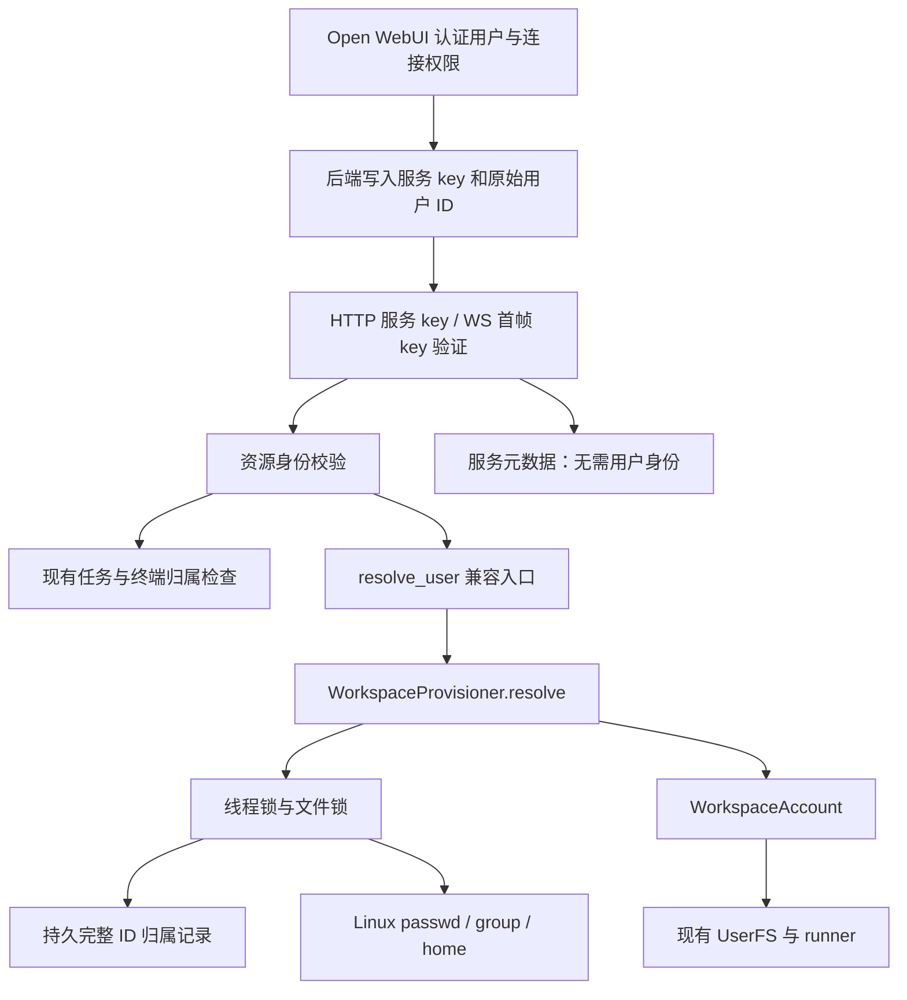
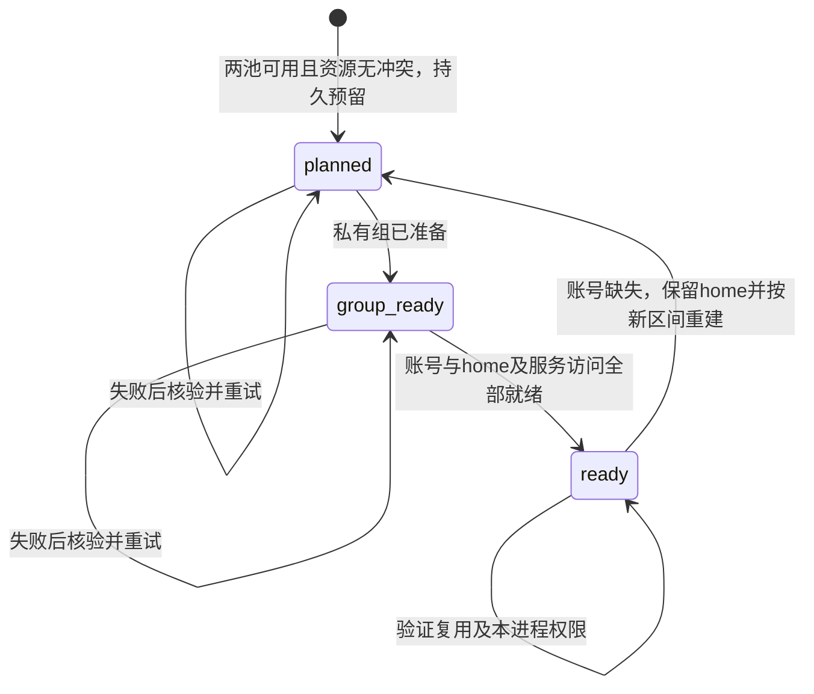

# 可信身份与工作空间归属模块设计

- 关联需求：[opt-user-space / REQ-001](../dev-workflow/opt-user-space/requirements.md)，AC-001～004、AC-032～033；恢复契约关联 REQ-007 的 AC-023、AC-034。
- 修订：v1.3，2026-10-29，精简接口注释；行为契约继续沿用 v1.2。
- 基线：Open Terminal 0.14.5；Open WebUI v0.12.3 只读；分支 `code/opt-req001`。
- 代码：[identity.py](../../open_terminal/utils/identity.py)、[user_isolation.py](../../open_terminal/utils/user_isolation.py)、[dependencies.py](../../open_terminal/dependencies.py)；接入位置 [main.py](../../open_terminal/main.py)。
- v1.0～v1.2 为 R2 设计、接口骨架与测试交付；后续实现及验收见 [R4 交接](../dev-workflow/opt-user-space/REQ-001/handoff-r4.md)和 [R5 交接](../dev-workflow/opt-user-space/REQ-001/handoff-r5.md)。v1.3 只精简当前实现中的接口注释，不修改业务逻辑或测试。

## 职责与范围

将上游认证的稳定账号 ID 映射到唯一 Linux 账号、同名私有主组及持久 home，并向现有 `UserFS`、命令和终端提供 `(username, home)`。本模块负责身份值合法性、完整归属证明、编号分配、并发准备及失败重试。

沿用管理员系统连接的实例 key、Open WebUI 认证和 HTTP/WS 协议。Terminal 不查询上游账号数据库，也不接收上游 JWT。共享容器的命令、进程和网络边界沿用 D01；文件路径授权、个人包环境、配额、账号删除、历史迁移不在本次设计内。Notebook 保留代码并关闭。

## 架构与接入



同一模块覆盖 REQ-001 的全部差距，不按验收编号拆成独立服务。新增纯身份模块不导入 `pwd`，保证显式单用户模式的跨平台导入不受影响。

R4 应将现有 `resolve_user` 改为调用默认 `WorkspaceProvisioner(username_prefix=USER_PREFIX)` 并返回元组；不改 `UserFS` 和执行器签名。原 `sanitize_username/ensure_os_user` 保留作为阅读基线，接线时不能继续用其“同名即复用”的逻辑决定资源归属；可复用 `_run_privileged` 和已有权限设置步骤。默认实例可复用，内存 `_user_cache` 不能跳过归属与本进程权限检查，首版可去掉成功缓存以减少失效分支。

## 身份与传输契约

`X-User-Id` 必须恰好出现一次，值完全匹配 ASCII `[A-Za-z0-9][A-Za-z0-9._:@-]{0,127}`，长度 1～128。短 ID、`root` 等上游标识有效；它们不会被当作 OS 账号名使用。空值、空白、控制字符、Unicode、路径分隔符、超长值、重复头均拒绝。保留大小写及每个字符，不 trim、清洗、截断或归一化；显示名、登录会话、聊天号不参与映射。该语法覆盖固定 WebUI 版本的 UUID ID，也为短标识规定了明确行为，不承诺任意旧客户端标识。

`require_user_identity(HTTPConnection)` 只校验并返回 ID，不创建账号。HTTP 服务凭据验证先于身份验证，身份验证先于资源查找、清理、扫描和写入；单用户模式返回 `None` 并维持旧行为。`get_filesystem` 也调用它，覆盖直接函数调用路径，并将准备异常转成下表的 HTTP 错误。

| 请求范围 | R4 接入与兼容要求 |
| --- | --- |
| `/files/*`、`/skills`、`/skills/read` | 所有实际注册方法先 key、再资源身份依赖；复用 `get_filesystem`。 |
| `/execute` GET/POST、`/{id}/status`、`/{id}/input`、DELETE `/{id}` | 列表/控制只验证身份并按原用户与聊天匹配；创建命令才准备工作账号。 |
| `/api/terminals` GET/POST、`/{id}` GET/DELETE、`/user/input`、`/user/output` | 同上；不得为列表新建账号。 |
| `/ports`、`/proxy/{port}/{path}` 全部七方法 | 先验证身份；准备失败向上传递。移除 `_visible_ports` 把身份/准备异常吞成空列表的行为。 |
| WS `/api/terminals/{id}` | accept 后验证现有首帧 key，再验证唯一身份头，再查找/检查 session 与存活状态；不得在认证前清理或暴露终端存在性。无效身份关闭 4001，reason=`Invalid user identity`；合法但不归属/不存在仍 4004；已连接仍 4009。不创建账号。 |
| `/system`、`/info` | 保留仅服务 key；WebUI 工具发现会无用户调用 `/system`。 |
| `/health`、`/api/config`、`/openapi.json`、文档入口 | 保留现有元数据认证行为，不增加必需用户头。 |

WS 继续优先使用 `X-Session-Id`，缺少聊天头时沿用首帧 `chat_id`；用户身份只能来自头，不能由首帧覆盖。不扩大聊天授权模型。HTTP/WS 共用语法与重复头规则，WS 单独转译传输错误，不直接发送 HTTPException。

固定版上游源码已只读核对：`routers/terminals.py` 的 HTTP/WS 均在认证/连接权限检查后构造用户头；`utils/tools.py` 的 AI 调用使用认证用户 ID，发现请求不总有 ID；`utils/terminals.py` 辅助请求覆盖同名身份头。实例 key 不在连接列表返回。本地测试不能证明实际普通账号未获取 key，仍需真实上游验收。

## 映射与持久记录

首次、尚未绑定用户的**首选候选名**按下列顺序生成：验证完整原始 ID；计算其 UTF-8 字节的 SHA-256，取小写十六进制表示的前 **8 位**；在前面拼接 `prefix`；**仅当拼接后的名称以数字开头时，在最前面补 `u`**。沿用原代码先拼 prefix 再检查首字符的顺序。十六进制的字母范围为 `a`～`f`，因此字母开头无需补 `u`。

`prefix` 沿用 `USER_PREFIX`，仍只允许空或 `[a-z_][a-z0-9_]{0,6}`；无效配置明确失败。不设置前缀时名称为 **8 或 9 字符**。非空合法前缀已提供合法首字符，不再补 `u`，总长为 9～15 字符。私有主组名等于账号名，以兼容 `UserFS._chown` 的 `username:username`。UID 与 GID 独立分配。

| 完整用户 ID | prefix | 前8位哈希 | 首选候选名 |
| --- | --- | --- | --- |
| `a` | 空 | `ca978112` | `ca978112` |
| `alice` | 空 | `2bd806c9` | `u2bd806c9` |
| `alice` | `team_` | `2bd806c9` | `team_2bd806c9` |

8 位十六进制有 2³²（约 42.95 亿）种取值，不保证首选名绝不重复。若正常用户 ID 的哈希近似独立均匀，n 个用户的首选名至少出现一对重名的概率约为 `1 - exp(-n(n-1)/(2×2^32))`：100 用户约 0.000115%，1000 用户约 0.0116%，9999 用户约 1.157%。**这是需要换候选名的概率，不是空间开通失败的概率。**同一 prefix 和条件补 `u` 都不增加随机空间。唯一性由锁内占用检查及持久预留保证，不能靠某个哈希长度或随机性本身证明。

**首次分配遇到重名，自动随机换一个同样短的名字。**在原全局准备锁内，先校验整份清单，再检查首选名是否已被其他完整 ID 的任意状态记录预留，或已有同名 Linux 账号、组、home 条目。home 占用包括文件、目录、符号链接及断链，使用 lstat/lexists 语义。任一占用就跳过候选，绝不接管或修改原对象。

接着调用 `generate_workspace_username(prefix)`，由 `secrets.token_hex(4)` 取得新的8位十六进制随机值，并应用相同的前缀和数字补 `u` 规则。继续在锁内检查全部占用；仍占用就继续换。首选候选之外，**最多随机抽取32次**，重复抽到同一值也计一次，避免无限循环。若全部候选都被占用，返回 `username_allocation_failed`（503），不新增用户绑定或系统对象；这个错误不声称整个名字空间已经用完。随机源异常返回 `workspace_unavailable`。

找到空闲候选、两池预检成功后，把最终账号名、prefix、home 和 UID/GID 原子写入 planned，再创建系统资源。**planned 一旦持久化，这个用户就已选定名称**：重复访问、失败重试、进程重启或保留卷重建均先查完整 ID 的记录并沿用它，不再随机，也不要求该名称等于首选哈希名。无需保存随机种子。若已有绑定与系统资源不一致，继续报 `identity_conflict`，不能靠换名掩盖数据归属错误。损坏清单或清单内已有两个绑定占用同一资源，也必须先失败，不能随机绕过。

上游 ID 为 `root` 只参与候选名生成；真正 root、UID<1000、服务进程实际 UID/eUID 永不作为工作账号。所有被跳过的候选账号、组及目录保持原状。

固定碰撞回归样例：`req001-collision-49585` 与 `req001-collision-89826` 的前8位哈希均为 `19042bfe`，因此无前缀首选名都为 `u19042bfe`。第一个用户可用该名，第二个用户会选一个已确认空闲的随机短名，例如 `a7c9e210`（仅为随机结果示例）。测试验证两用户最终都成功且账号、目录、UID/GID 不共享，第一用户数据不变，第二用户之后仍沿用保存的随机名称。完整 ID 清单与 GECOS 中的完整64位摘要保持不变。

默认在 `/home/.open-terminal/` 保存 `registry.json` 和独立 `provision.lock`。这是 `/home` 卷上的小型归属清单，不新增数据库或账号同步服务。必须保留完整 `/home` 卷，包括此目录；不能只保留各用户子目录。目录由服务账号拥有、0700；清单与锁 0600。服务账号依据真实 UID/passwd 确定，不信任 `USER` 环境值。新建目录可经既有特权执行器完成；已存在目录须核对类型、属主和权限，拒绝符号链接或不可验证的管理目录。

v1 外部存储契约示例（两个用户的首选哈希同名；第二个用户名为随机结果示例，号码仅示例）：

```json
{
  "version": 1,
  "users": {
    "req001-collision-49585": {
      "username": "u19042bfe",
      "prefix": "",
      "home": "/home/u19042bfe",
      "uid": 10001,
      "gid": 10001,
      "state": "ready"
    },
    "req001-collision-89826": {
      "username": "a7c9e210",
      "prefix": "",
      "home": "/home/a7c9e210",
      "uid": 10002,
      "gid": 10002,
      "state": "ready"
    }
  }
}
```

`users` 的键就是完整、区分大小写的原始 ID。记录不得丢失此键后再靠哈希猜测。加载时验证 schema、字段类型、身份语法、所存 prefix、短用户名形状、路径根、唯一性与状态，不接受重复 JSON 键、坏 JSON、未知版本或不完整记录。名称的形状按所存 prefix 与8位十六进制及补 `u` 规则检查，**不重新用 ID 计算哈希来否定已保存的随机名**。损坏不等同空库；不得覆盖损坏文件进行“自动修复”。有效文件内不同 ID 的已绑定资源重复仍报 `identity_conflict`；结构/格式无效报 `workspace_state_invalid`。本次在未部署的 schema v1 设计中补充 prefix 字段，不存在旧运行清单升级或自动迁移。

只有首次部署不存在清单才可以建空库。无记录旧 home 不自动导入，首次候选若命中它应换名；本次无历史迁移，记录缺失不是授权接管的依据。若旧账号已有可验证 v1 归属记录，且 Linux 账号仍存在，则可沿用区间外非保留编号；这不意味着从旧版未记录账号自动建立 v1 归属。现存账号的名称、UID/GID、home、私有组、GECOS 必须与记录一致。GECOS 使用 `ot-` 加完整 ID 的64位 SHA-256（不含 passwd 字段分隔符冒号）；它是账号重试核验辅证，不能取代完整 ID 清单。

变更 prefix/home_root 后不得把已绑定用户悄悄迁往新目录：逐条比较记录内 prefix 与当前配置，并核对记录的 home 根；不符报 `workspace_config_invalid`。不能通过重新计算首选名来判断配置是否相符。稳定 ID、保留归属记录和映射配置是恢复前提。state_dir/home_root 构造参数供隔离测试使用；生产使用默认路径，不新增普通用户可配置入口。

## 并发、分配与恢复

首版用一把串行准备锁，简化编号竞争：进程内按规范化 state_dir 共享 `threading.Lock`，再对固定 `provision.lock` 打开独立文件描述符并 `flock(LOCK_EX)`。锁覆盖读清单、候选检查及随机换名、查 NSS、预留、账号创建、权限准备和 ready 提交。线程锁与文件锁共享 30 秒获取截止时间，超时 `workspace_busy`；释放放在 finally。锁文件不删除/替换，清单原子替换不能改变锁 inode。所有 worker 使用同一 state_dir；不支持多个独立容器共享一份 OS 账号数据库语义。

Linux 用户/组号分别查 NSS 全量占用，叠加其他未完成记录的预留；各自在 10001～19999 中选最小空号。两池全部预检成功才写 planned 和执行系统变更。纯分配函数不预留、不改变输入；并发保证由其调用方承担。若两池均耗尽，先报告 UID 耗尽。禁止 `useradd -o` 或区间外回退。



每次记录变更写同目录临时文件（0600）、flush/fsync、原子 replace 后 fsync 父目录。未落盘的预留不能开始系统创建。操作系统账号修改经 `_run_privileged` 传参数数组执行，明确 `groupadd -g`、`useradd -u -g -d -s /bin/bash -c <marker>`，禁止 shell 字符串拼接。复用已保留的 home 时不覆盖用户文件；递归属主修正仅用于已证明归属的恢复目录，不能遍历到外部符号链接目标。

| 观察到的状态 | 行为与失败边界 |
| --- | --- |
| 无记录，候选名未被记录预留且账号/组/home均不存在 | 预检两池，持久保存所选名称及 prefix，创建 planned。 |
| 无记录，但候选已被其他记录或任一系统资源占用 | 跳过候选，最多随机抽取32次查找空闲名，不修改原资源。全部尝试仍占用才报 `username_allocation_failed`，不落新用户绑定。 |
| 已有 planned/group_ready/ready 记录 | 先使用记录内选定的名称，无论是否为首选哈希名都不再抽样。绑定异常继续明确失败，不换名绕过。 |
| planned，组尚不存在 | 使用预留 GID 创建并提交 group_ready。预留号被其他名称占用则重新预检两池并更新该未创建预留；不改占号对象。 |
| planned，已存在同名同 GID 孤组 | 预留记录作为失败重试依据；只有没有其他账号以它为主组、没有未授权成员且无另一绑定时可接续。可容忍 groupadd 成功后进程退出的窗口。 |
| group_ready，账号不存在 | 用预留 UID 创建带完整 marker 的账号。UID 被他人占用则仅重选尚未创建的 UID；不能换掉已经创建的私有组。 |
| planned/group_ready，账号已存在 | 逐项核对名称、UID/GID、home、marker、私有组；匹配才继续权限准备，处理 useradd 成功但 ready 未提交的窗口。 |
| 权限/成员关系/清单写入失败 | 返回 `workspace_unavailable`，保留可诊断状态，绝不缓存或返回半成品；下次在锁内重试。不执行 userdel 或删 home 回滚。 |
| ready 且账号存在 | 验证原记录和 OS，沿用编号；补齐当前服务进程所需附加组，不重新分配。 |
| ready 且账号已不存在、可信 home仍在 | 按新建范围预检并记录新的编号；若原私有组仍存在且可证明归属、无其他主用户，可在范围内沿用其 GID；区间外的孤组须先安全移除再新建，禁止改号影响其他账号。若无法证明可安全处置，冲突失败。恢复原home内容与属主，允许编号变化。 |
| 已有绑定的 home 是符号链接/非目录，或绑定账号/组不匹配 | `identity_conflict`，不跟随、不 chown、不猜测归属，不随机换名。 |
| 元数据损坏、权限不足、磁盘满、锁超时 | 对应可诊断错误，保留用户数据，不默认回退。 |

正常服务内部的并发由锁和持久预留解决。不承诺与管理员并发手工重建同名同号系统对象的事务一致性；不将任意命令或恶意修改元数据纳入 D01。占号检查仍覆盖请求开始前的既有账号/组，以及系统工具报告的竞争失败。

返回 ready 前须保证 home 为 2770、账号与私有组属主正确、服务账号在所需组且当前进程已刷新附加组。刷新失败若无法实际访问 home，必须失败；不能只记录 warning 后宣称成功。root 服务可直接访问，仍须核对账号/组/home。保留已有可选 Docker socket 附加组行为，不限制合法成员维护，也不改变任何已有附加组编号。Linux 标准运行镜像支持该模式；OpenShift 受限镜像仍不支持。

本次不实现每个请求的账号修复框架。R4 应使用有界特权命令超时，IO/系统错误转译为 `workspace_unavailable`，保留失败步骤供受控日志诊断；锁仅串行初始化/核验，不覆盖用户命令运行。REQ-007 将补齐真实卷重建、重启和升级验证。

## 错误与兼容契约

HTTP 准备错误统一 `{"detail":{"code":"...","message":"Workspace preparation failed"}}`；身份错误 message 为 `Invalid user identity`。不得直接返回异常 message、原始 stderr、其他用户 ID/目录或服务凭据。代码提供可诊断分类，受控日志记录失败步骤与当前操作号，不输出服务 key。

| code / 情况 | HTTP | WS |
| --- | --- | --- |
| 无/错服务 key | 401，沿用现有响应 | 4001，沿用首帧协议 |
| `invalid_user_identity` | 400 | 4001，固定身份错误 reason |
| `identity_conflict` | 409 | WS 不准备账号，不产生此错误 |
| `uid_pool_exhausted`、`gid_pool_exhausted` | 503 | 同上 |
| `username_allocation_failed`：首选及32次随机候选仍占用 | 503 | 同上 |
| `workspace_busy`、`workspace_unavailable` | 503 | 同上 |
| `workspace_state_invalid`、`workspace_config_invalid` | 500 | 同上 |
| 合法身份但任务/终端不归属或不存在 | 保留 404 | 保留 4004 |

不修改成功响应结构、任务 owner 字段、聊天分组或终端数据帧。多用户缺头的 400 响应改为稳定对象详情；现有部分列表的空列表/404 收紧为统一 400。服务元数据不受此调整影响。

## 接口与验证依据

接口注释仅保留职责、输入/输出及关键异常和约束。认证链路、完整状态机、存储格式、碰撞概率、权限与恢复细节统一以本文为准，避免在每个函数中重复展开。

| 入口 | 骨架/契约 | 验收与测试 |
| --- | --- | --- |
| `validate_user_id` | identity.py；原样值、语法与异常 | AC-001/002/003；test_identity_values.py |
| `require_user_identity` | dependencies.py；重复头、单用户兼容、无准备副作用 | AC-003；test_identity_dependency.py、test_identity_http.py |
| `derive_workspace_username` | user_isolation.py；完整ID派生候选名 | AC-001/002；test_workspace_provisioning.py |
| `generate_workspace_username` | user_isolation.py；随机8位候选名，不负责占用检查 | AC-002/004；test_workspace_provisioning.py、test_workspace_recovery.py |
| `allocate_workspace_ids` | user_isolation.py；闭区间、独立取号、耗尽 | AC-032/033；同上 |
| `WorkspaceProvisioner.resolve` | user_isolation.py；持久归属、OS准备与重试 | AC-001/002/004/032/033、AC-023/034；test_workspace_provisioning.py、test_workspace_recovery.py |
| 既有 `resolve_user/get_filesystem` 和真实 app | R4 接线位置，R2不改既有业务逻辑 | HTTP/WS测试验证真实路由；不能仅让新类单测通过 |

测试目录为 [tests/req001](../../tests/req001)。测试使用 pytest，断言最终正确行为，无 xfail 或以 NotImplementedError 通过的分支。纯边界函数测试覆盖两池耗尽；resolver 另用真实 NSS 预占不同 UID/GID，验证实际准备会分别跳号，并通过外部 NSS 全占号快照模拟两池耗尽，不建立上万个账号。OS 测试直接观察 Linux passwd/group/home，要求一次性 root Docker 容器，覆盖同/异用户、多线程/进程、首次撞名换名、已有绑定冲突拒绝、持久状态和重试。随机测试只替换外部 `secrets.token_hex` 的输出，不替代生成函数或 resolver；验证连续撞名、重复候选、32次上限以及已保存随机名在失败重试/账号恢复时不再抽样。系统命令失败只在外部 `_run_privileged` 的目标 home 权限步骤注入，不替代被测业务结果。

HTTP 使用真实 app/TestClient，隔离账号准备边界、端口扫描和空运行态，不启动后台维护 lifespan；验证所有已启用用户资源方法、认证顺序、重复头、错误转译及元数据兼容。WS 用受控外部进程存活对象验证拒绝路径。语法测试直接触达新入口；既有路由回归可通过，尚未接线的合同测试应失败。

执行命令、镜像及实际红/绿基线见 [R2 交接单](../dev-workflow/opt-user-space/REQ-001/handoff-r2.md)。这些测试不证明完整 AC 已验收：真实 WebUI A/B 认证与 key 保管、正常 PTY 首帧/收发、非 root 服务进程组刷新、真实满号池环境、崩溃刷盘/磁盘满、真实保留卷重建及完整个人环境生命周期仍需 R4/REQ-007/REQ-008 联调。骨架未实现时，相应深层 OS/恢复断言尚未执行到，不能把编写覆盖当作运行通过。

## 交接界限

本次没有待人工业务决定；上述身份语法、命名、状态文件和错误码是 R2 技术设计选择。R3 在独立对话据此编写 REQ-001 计划，R4 才实现和接线。其他需求设计、生产容器部署、测试账号开通及跨对话推进均留待用户指定；不将 R2 ready 等同业务实现或验收通过。

## 修订记录

| 修订 | 日期 | 来源与处理 |
| --- | --- | --- |
| v1.0（历史，已替代） | 2026-10-27 | 首次 R2 设计采用较长的固定哈希账号名，已由 v1.1 的短名规则替代。 |
| v1.1（历史，部分已替代） | 2026-10-28 | 改为8位哈希，拼 prefix 后仅数字开头补 `u`；当时首次重名直接拒绝的策略已由 v1.2 自动随机换名替代。 |
| v1.2（契约沿用） | 2026-10-28 | 用户指出可在首次重名后随机重选：最多32次随机8位候选，确认空闲后持久绑定并跨重试/重建复用；清单加 prefix，新增错误及相关测试。同步清理旧例示歧义，当前示例全部使用8位主体。完整ID归属、已绑定异常拒绝及UID/GID规则不变。 |
| v1.3（当前） | 2026-10-29 | 按用户要求精简 identity.py、dependencies.py、user_isolation.py 的12处注释，删除重复流程与背景，保留接口关键契约并引用本文。当前已有R4/R5实现保持；去除docstring后的AST及源码文本与修改前一致，未改测试。 |
